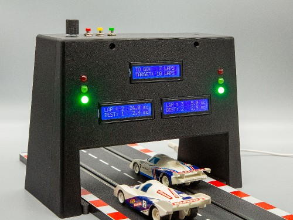

# Carrera_Race_Monitor V1.1.0

Carrera Race Monitor (CRM) is a device for controlling and monitoring slot car races.

You can use it to count laps with lap times and fastest laps for up to two tracks.
 CRM supports different race modes, such as open races, lap-limited or time-limited races.
 Optionally, you can activate start-control with phases of car-lineup, traffic-light controlled start and false start control.
 With start-control activated, you may also configure handicaps which delay the start on one track with respect to the other by a certain number of seconds.

All functions and configurations are accessible through simple push buttons and a selector button.
 Configured settings can be saved as default for future CRM starts.

CRM is multilingual and supports language switch during operation.
 Currently supported languages are English and German, however the infrastructure for translation is part of the system and can be used by end users for adding new languages or modifying existing ones.

CRM can be adjusted to different track widths. It supports most of the Carrera models but is not restricted to this brand.

While the current version is restricted to functions included in the CRM bridge itself, future software extensions may include web access through mobile devices such as a tablet as well as support of an integrated camera.

Carrera Race Monitor is built from a 3D printed housing with off-the-shelf electronics components controlled by a Raspberry Pi Zero.

Print files are available at [https://makerworld.com/en/models/3564315-carrera-race-monitor](https://makerworld.com/en/models/3564315-carrera-race-monitor)

See the [CRM_Assembly_Instructions_en.pdf](./doc/CRM_Assembly_Instructions_en.pdf) for required parts and assembly instructions.

See the [CRM_User_Guide_en.pdf](./doc/CRM_User_Guide_en.pdf) for usage instructions.

This repository hosts the CRM software as well as the latest documentation.
 The software is written in Python and Flask.

Installation as well as updates to the latest version are done using an automatic installer (see [CRM_User_Guide_en.pdf](./doc/CRM_User_Guide_en.pdf) ch. 9)

Bugfixes and new features are tracked in the [Release Notes](./doc/Release_Notes.md).

