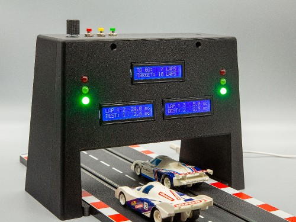

Carrera Race Monitor (CRM) is a device for controlling and monitoring slot car races.

All functions and configurations are accessible through simple push buttons and a selector button.
 Configured settings can be saved as default for future CRM starts.

CRM is multilingual and supports language switch during operation.

CRM can be adjusted to different track widths. It can be used with most of the Carrera models but is not restricted to this brand.

Carrera Race Monitor is built from a 3D printed housing with off-the-shelf electronics components controlled by a Raspberry Pi Zero.

See also:

- [3D Print Files at MakerWorld](https://makerworld.com/en/models/3564315-carrera-race-monitor)
- [CRM_Assembly_Instructions](./CRM_Assembly_Instructions_en.pdf)
- [CRM_User_Guide](./CRM_User_Guide_en.pdf)

